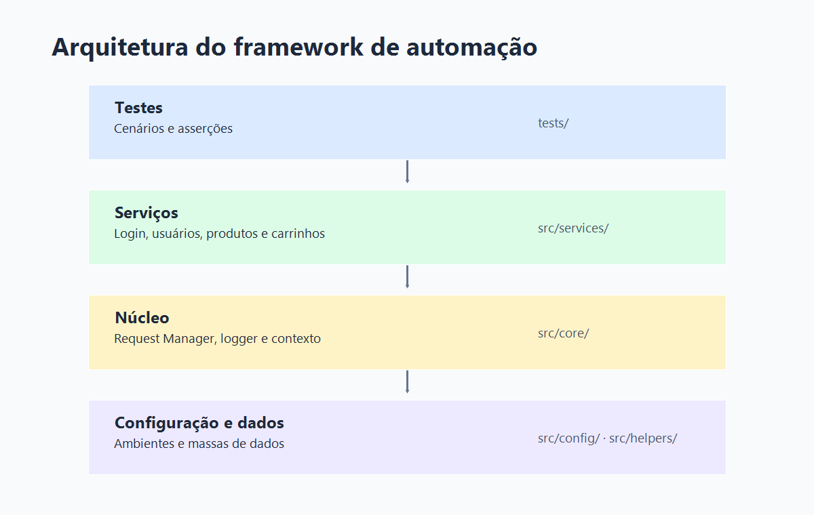
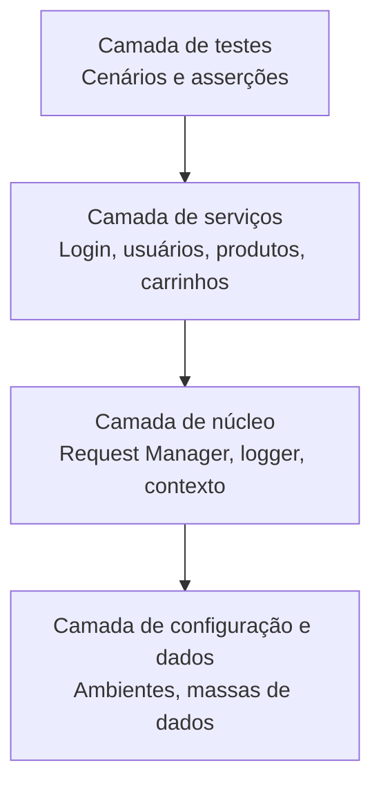

# Arquitetura do framework de automação

## Camadas

- **Testes (`tests/`)**: descrevem cenários, preparam pré-condições e verificam respostas. Os testes existentes permanecem nessa pasta para preservar os comandos e a estrutura atual do projeto.
- **Serviços (`src/services/`)**: oferecem operações de negócio reutilizáveis para login, usuários, produtos e carrinhos. Não devem conter asserções de teste.
- **Núcleo (`src/core/`)**: concentra recursos transversais, como o Request Manager, logger e contexto da execução. Os serviços usam o núcleo para interagir com a API.
- **Configuração e dados (`src/config/`)**: reúne configuração de ambientes e geração de massas de dados. O núcleo lê essa configuração; dados sensíveis devem vir do ambiente e não ser registrados em logs.

## Regra de dependência

Testes chamam serviços; serviços chamam o núcleo; o núcleo lê configuração e dados. Nenhuma camada chama uma camada acima dela. Configuração e dados não dependem das camadas superiores.

## Organização atual

O repositório já tinha testes em `tests/poc` e `tests/migration`, além de configuração e geradores de dados em `src/config` e `src/helpers`. Essa estrutura foi mantida. `src/services` e `src/core` são os pontos de extensão para a arquitetura; não foram criados serviços vazios nem migrados testes sem necessidade.
