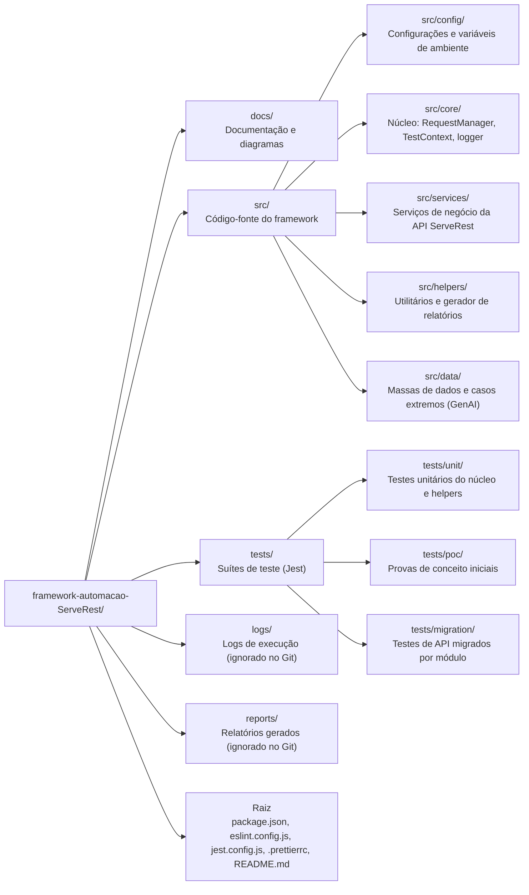

# Estrutura do Projeto

A estrutura de diretórios e arquivos do framework foi organizada para refletir diretamente a arquitetura em quatro camadas definida em [arquitetura.md](arquitetura.md), separando cenários de teste, serviços de negócio, núcleo transversal, configurações, massas de dados, logs e relatórios.

## Diagrama de Estrutura



## Árvore de Pastas Comentada

```text
framework-automacao-ServeRest/
├── docs/                                 # Documentação técnica, diagramas e convenções da equipe
│   ├── arquitetura.md                    # Definição das 4 camadas e regras de dependência
│   ├── arquitetura.png                   # Diagrama visual da arquitetura em camadas
│   ├── convencoes-logger.md              # Padrão de níveis, formato e dados proibidos nos logs
│   ├── dados-genai.md                    # Prompt, procedimento e revisão dos dados gerados por IA
│   ├── estrutura.md                      # Diagrama e árvore comentada da estrutura do projeto
│   ├── exemplo-relatorio-logs.md         # Exemplo de relatório gerado a partir dos logs
│   ├── qualidade-de-codigo.md            # Regras de ESLint/Prettier e registro de execução
│   └── singleton-request-manager.md      # Diagrama de classes do Singleton RequestManager
├── logs/                                 # Arquivos de log gerados por execução (ignorado pelo Git)
├── reports/                              # Relatórios resumidos gerados dos logs (ignorado pelo Git)
├── src/                                  # Código-fonte de suporte aos testes
│   ├── config/                           # Camada de configuração e ambiente
│   │   └── api.js                        # Centraliza BASE_URL e parâmetros de ambiente
│   ├── core/                             # Camada de núcleo (recursos transversais)
│   │   ├── context.js                    # TestContext: compartilhamento de variáveis entre etapas
│   │   ├── logger.js                     # Logger estruturado em arquivo (Winston)
│   │   └── requestManager.js             # Singleton que centraliza requisições HTTP via Supertest
│   ├── data/                             # Massas de dados estáticas e de borda (JSON)
│   │   ├── produtos.edge.json            # Casos extremos e variações para /produtos (GenAI)
│   │   └── usuarios.edge.json            # Casos extremos e variações para /usuarios (GenAI)
│   ├── helpers/                          # Funções auxiliares e utilitários
│   │   ├── logReport.js                  # Parser de logs e gerador de relatório em Markdown
│   │   └── utils.js                      # Geradores dinâmicos de e-mail e nome de produto únicos
│   └── services/                         # Camada de serviços (abstração dos endpoints ServeRest)
│       ├── authService.js                # Operações de autenticação (/login)
│       ├── cartService.js                # Operações de carrinhos (/carrinhos)
│       ├── productService.js             # Operações de produtos (/produtos)
│       └── userService.js                # Operações de usuários (/usuarios)
├── tests/                                # Camada de testes (cenários e asserções Jest)
│   ├── migration/                        # Testes de integração migrados para o framework
│   │   ├── 01_login.test.js              # Cenários do módulo /login
│   │   ├── 02_usuarios.test.js           # Cenários do módulo /usuarios
│   │   ├── 03_produtos.test.js           # Cenários do módulo /produtos
│   │   └── 04_carrinhos.test.js          # Cenários do módulo /carrinhos
│   ├── poc/                              # Provas de conceito originais com Supertest
│   │   ├── getUsuarios.test.js           # PoC de consulta pública GET /usuarios
│   │   └── postLogin.test.js             # PoC de autenticação POST /login
│   └── unit/                             # Testes unitários dos componentes internos
│       ├── context.test.js               # Validação do TestContext
│       ├── logReport.test.js             # Validação do parser e gerador de relatório de logs
│       └── requestManager.test.js        # Validação do padrão Singleton no RequestManager
├── .env.example                          # Modelo de variáveis de ambiente para a equipe
├── .gitignore                            # Ignora node_modules/, .env, logs/, reports/ e coverage/
├── .prettierrc                           # Configuração de formatação do Prettier
├── CONTRIBUTING.md                       # Fluxo de contribuição, branches e revisão por pares
├── eslint.config.js                      # Regras de lint (ESLint 9 flat config + Jest)
├── jest.config.js                        # Configuração do executor de testes Jest
├── package.json                          # Dependências e scripts npm (test, lint, format, report)
└── README.md                             # Documentação principal do framework
```
