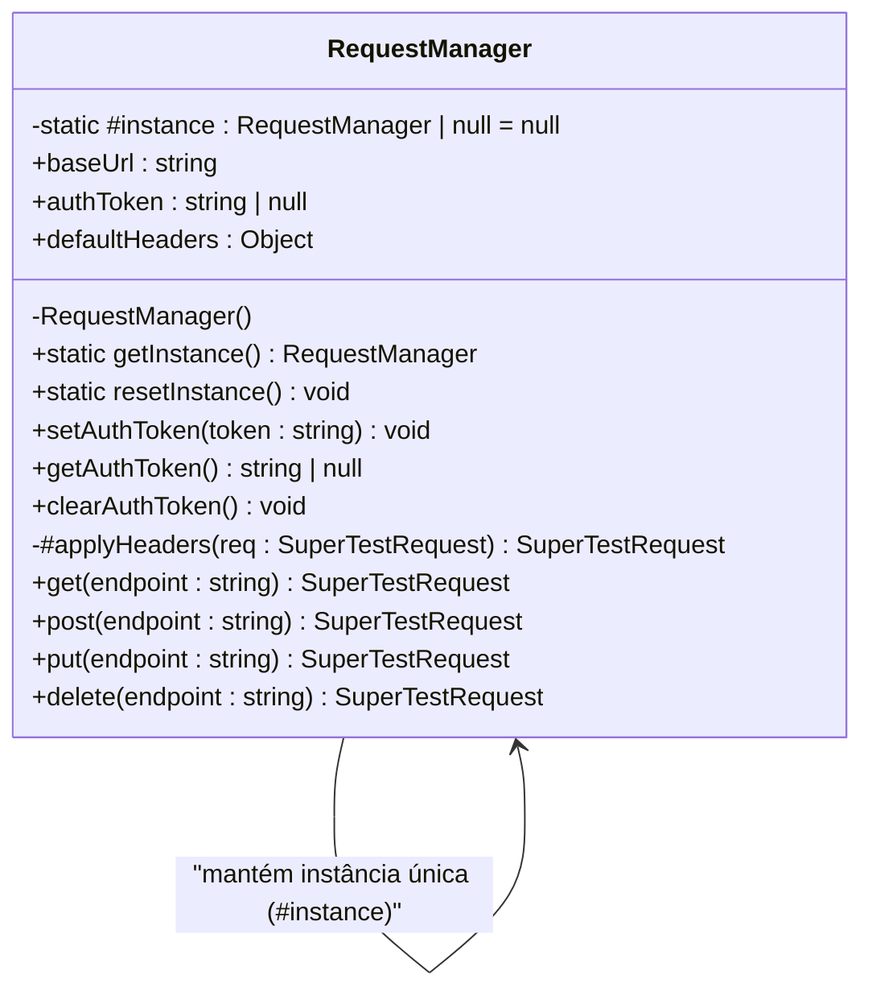

# Diagrama do Singleton — RequestManager

O gerenciador de requisições (`src/core/requestManager.js`) implementa o padrão de projeto **Singleton** para garantir que toda a suíte de testes compartilhe uma única instância responsável pela configuração da `BASE_URL`, cabeçalhos padrão e token de autenticação.

## Diagrama de Classes

## Descrição da Implementação

1. **Atributo da instância única (`static #instance`):** campo privado estático inicializado com `null` que armazena a única instância permitida da classe durante a execução.
2. **Construtor restrito (`constructor()`):** verifica se `RequestManager.#instance` já está preenchido. Caso positivo, lança um `Error` impedindo instanciações diretas via `new RequestManager()`. Na primeira criação, inicializa `baseUrl` (vinda de `src/config/api.js`), `authToken` (`null`) e `defaultHeaders` (`Content-Type` e `Accept` como `application/json`).
3. **Método de acesso (`static getInstance()`):** ponto global de acesso. Se `#instance` ainda for `null`, cria a instância única; nas chamadas seguintes, retorna sempre a mesma referência.
4. **Métodos auxiliares e HTTP:** `setAuthToken`, `getAuthToken` e `clearAuthToken` gerenciam o token compartilhado; `#applyHeaders` (método privado) injeta os cabeçalhos padrão e o header `Authorization` (quando presente) nas requisições `get`, `post`, `put` e `delete` criadas com `supertest`. O método `static resetInstance()` permite reiniciar o estado em testes unitários.
